# Forthy

**A native Laravel workbench for macOS.**

Run code in the real context of your Laravel app, inspect models, tables, routes and
config, browse your app's files, stream Artisan and follow your logs — from a local
project, Docker, SSH or a Kubernetes pod.

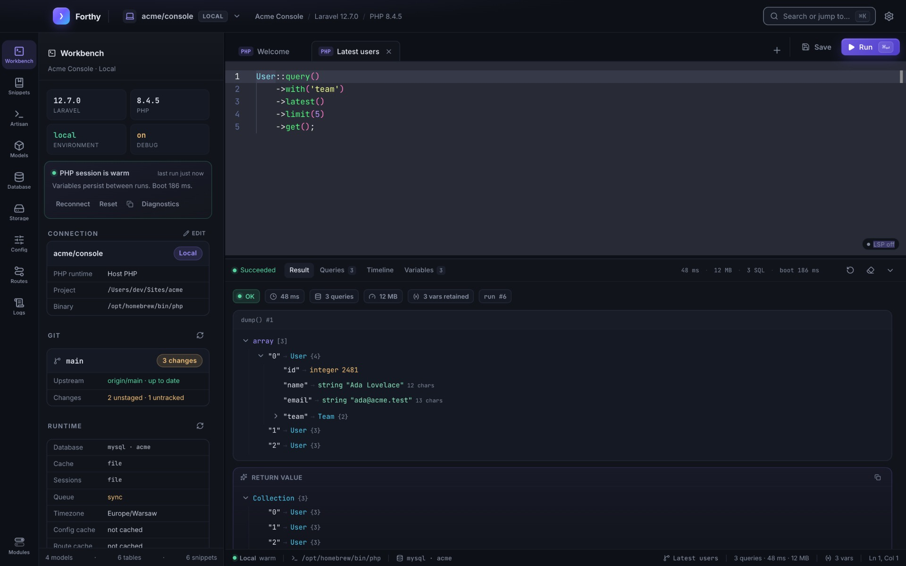

## Download

[**Download the latest version**](https://github.com/stealthpro/forthy-app/releases/latest/download/Forthy-macos-aarch64.zip)
· [All releases](https://github.com/stealthpro/forthy-app/releases) · [Website](https://stealthpro.github.io/forthy-app/)

Apple Silicon (arm64), macOS 11 or later. The build is ad-hoc signed, so on first launch
use **right-click → Open**. Forthy 0.7.6 and newer update themselves from inside the app:
accept the update notice, then confirm the restart. Verify the download with the `.sha256`
file from the release page:

```bash
shasum -a 256 -c Forthy-macos-aarch64.zip.sha256
```

## What it does

- **Tinker** — write PHP and run it inside the running application, with structured
  dumps (models, collections, arrays, exceptions) and a query log with bindings and
  timing.
- **Snippets** — save and reuse code, tag destructive snippets, and keep a history of
  every run.
- **Artisan** — a searchable command list with favorites, streaming output and console
  tabs.
- **Models** — an Eloquent reference for the real app: attributes, casts, relations,
  methods and scopes.
- **Database** — browse tables with a typed filter builder, page through rows and export;
  the connection picker only offers databases that really exist and already hold tables.
- **Storage** — every disk from `config/filesystems.php`: browse folders in a
  file-manager tab, preview text, CSV, Excel, Word, PDF and images in place, download any
  folder as an archive and upload with a destination-first dialog.
- **Routes and config** — the actual route table and configuration tree of the running
  app.
- **Logs** — follow channel and daily files, with parsed levels and stack traces.
- **Command palette** — one search over modules, tables, models, routes, snippets and
  past runs.
- **Any target** — local PHP, Docker, SSH (key or password) and Kubernetes pods,
  with contexts, namespaces, pods and containers picked from the cluster's own
  lists; a pod that a rollout replaced is offered again instead of leaving the
  connection broken.
- **Locks** — optionally ask macOS to authenticate with Touch ID or the Mac account
  password before the app opens or before a chosen project does. Locked connections stay
  marked, and Forthy stores only a flag — never a password.
- **Themes** — dark, light or follow the system.
- **Updates** — checks the public release feed, then downloads and installs a new
  version only after you confirm it. Every archive is signature-checked first, and
  **Check for Updates…** in the application menu runs the same check on demand.
- **Safety** — destructive code is flagged and confirmed before it runs; secrets are
  never written to disk, and the optional locks are checked by macOS without the app ever
  seeing the password.

## Screenshots

Every frame comes from the same demo project (`acme`) with fictional paths and data.

| Welcome | Database |
| --- | --- |
| 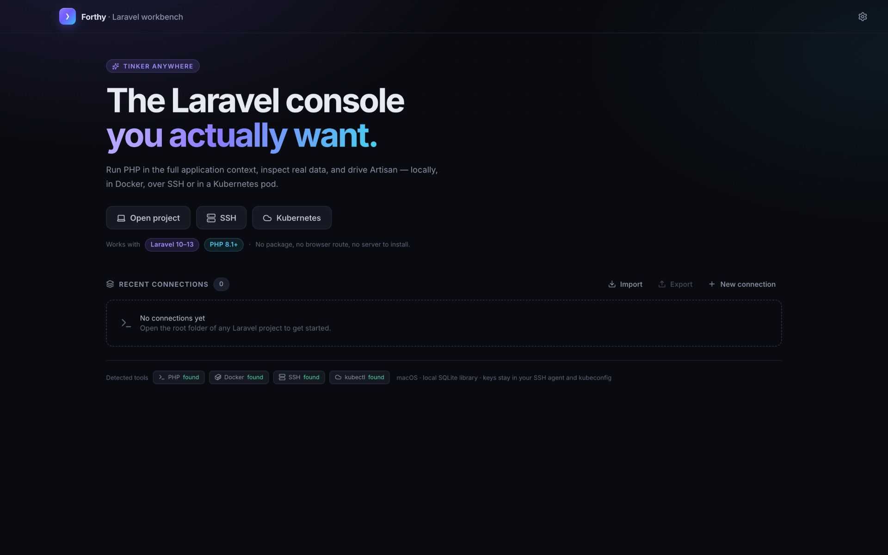 | 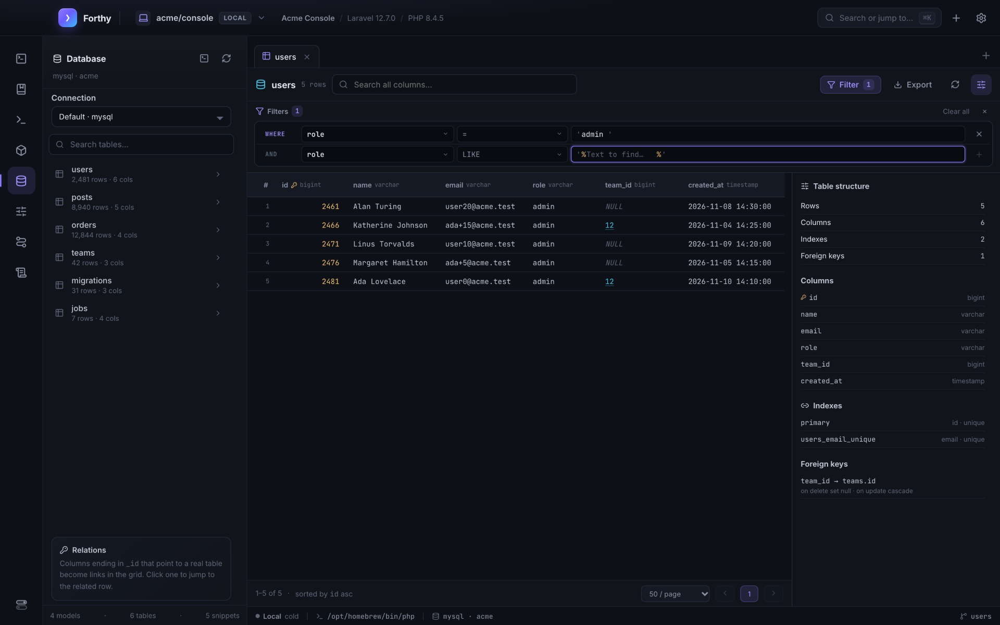 |

| Models | Artisan |
| --- | --- |
| 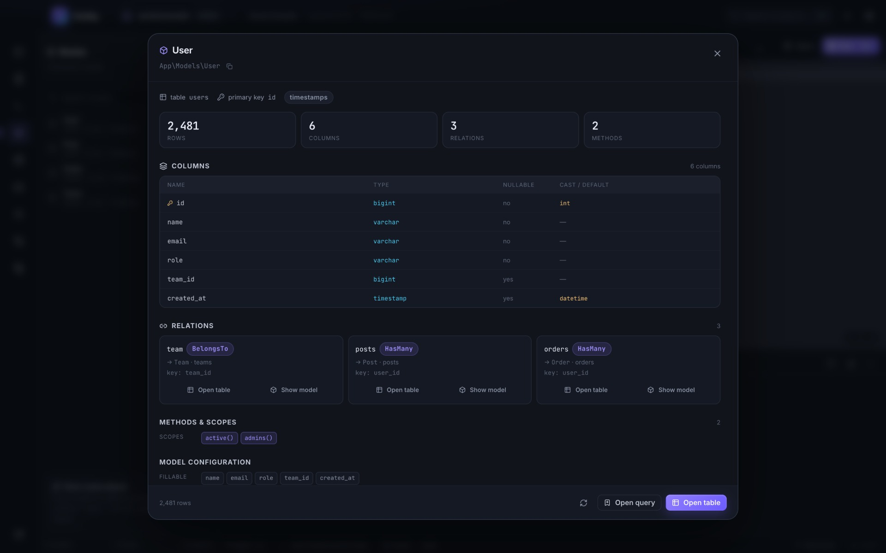 | 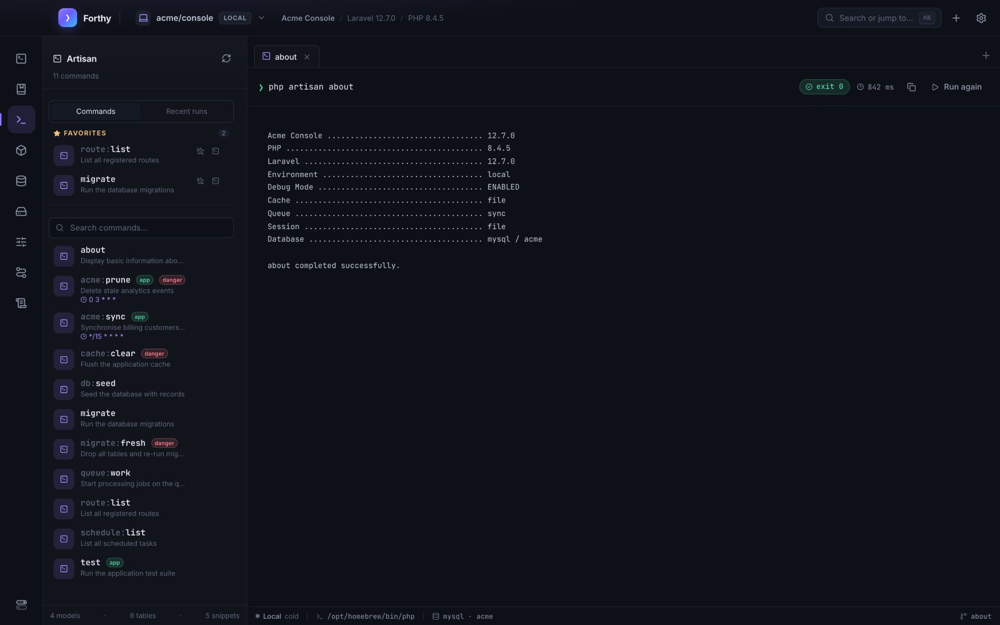 |

| Routes | Config |
| --- | --- |
| 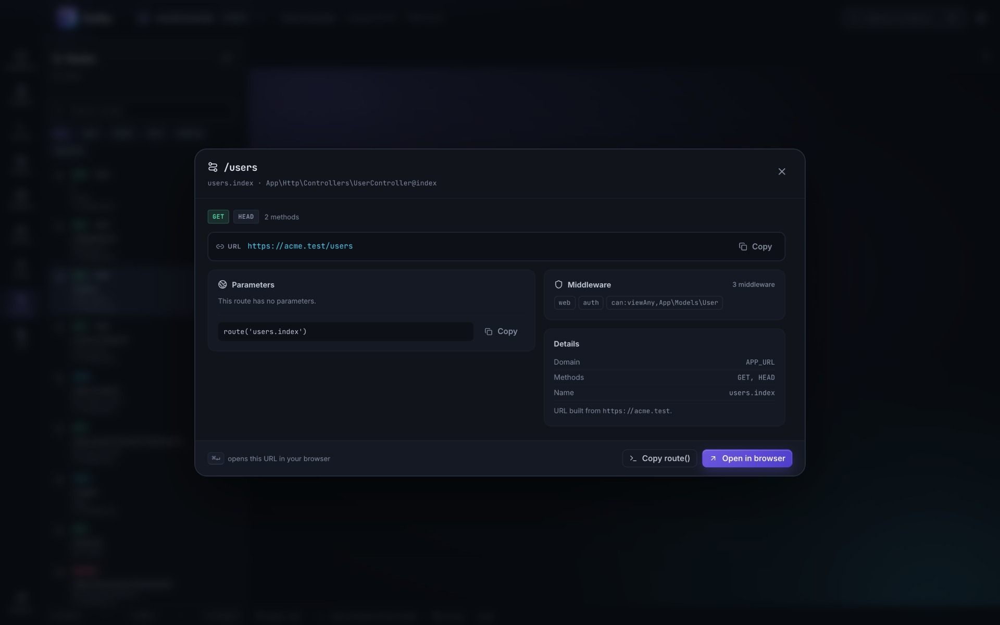 | 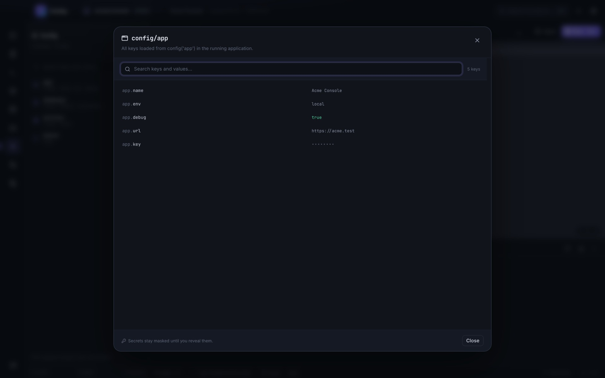 |

| Logs | Snippets |
| --- | --- |
| 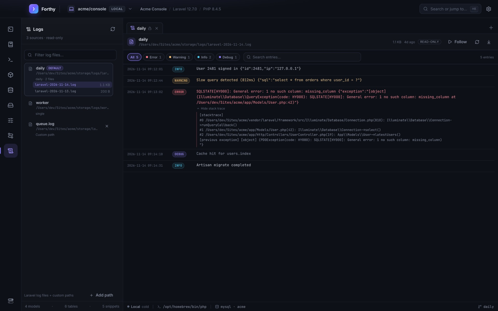 | 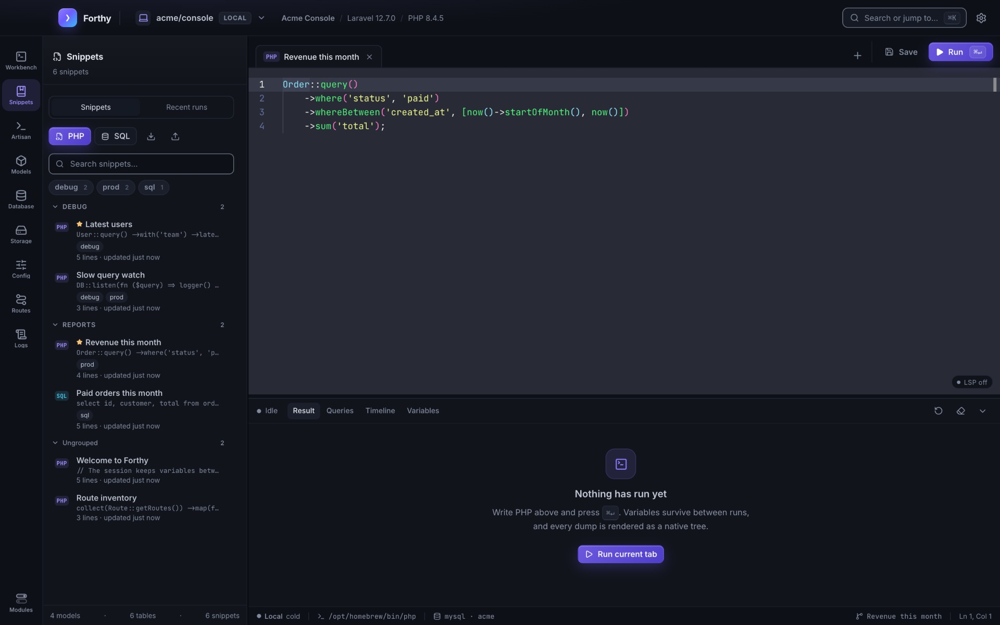 |

| Command palette | Settings |
| --- | --- |
| 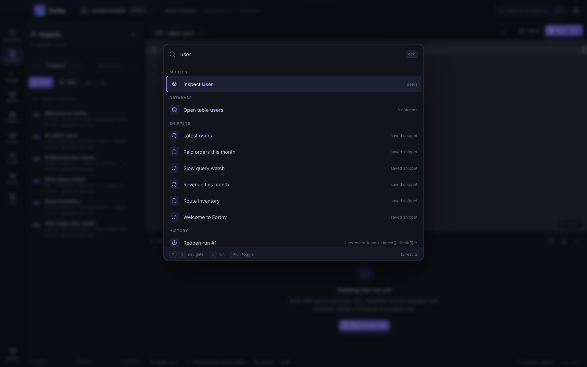 | 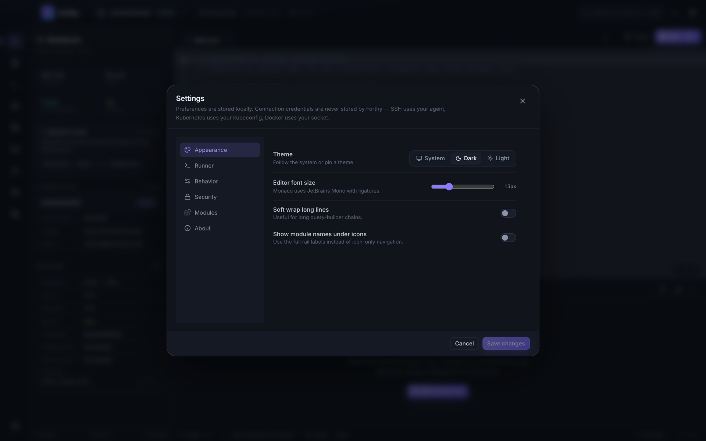 |

### Files and disks

Storage browses the disks of the running application: previews images, CSV, Excel, Word
and PDF files in place, downloads any folder as an archive and uploads into the folder
you pick.

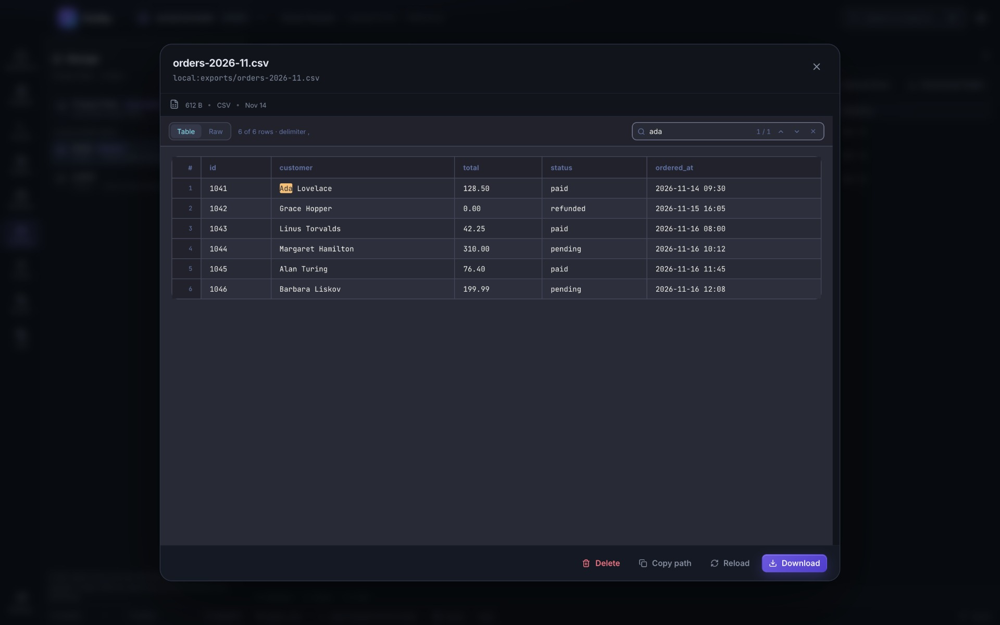

### Completions from the running app

The editor completes config keys from the running application, not from a copy of the
config files.

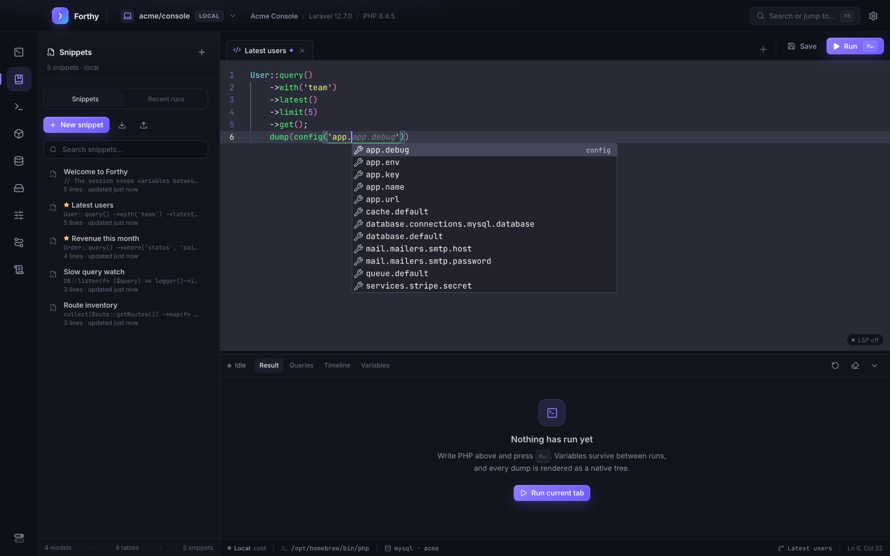

## Requirements

- macOS 11 or later (Apple Silicon)
- PHP 8.1+ on the host, or a Docker, SSH or Kubernetes target
- A Laravel 10–13 project

## Install

1. Download the zip from [Releases](https://github.com/stealthpro/forthy-app/releases).
2. Unzip it and open `Forthy.app` (right-click → Open on the first launch).
3. Add a connection: a local project, Docker, SSH or Kubernetes.

## Privacy

Connections, snippets and settings stay on your machine. SSH passwords live in memory
only, and the optional app/connection locks store a flag while macOS performs the
authentication. There is no telemetry, and your code is not sent anywhere. The only automatic
network request is the update check: it fetches a signed manifest from the public GitHub
release, which reveals your IP address and the Forthy version as any HTTPS request does,
and nothing about your projects. Automatic checks can be turned off in Settings →
Behavior.

## Support

Bugs and feature requests: [open an issue](https://github.com/stealthpro/forthy-app/issues).
Please include the Forthy version, macOS version and connection type, and remove passwords,
keys and customer data from anything you paste.

Security problems: follow [SECURITY.md](SECURITY.md) and report them privately — never in a
public issue.

## License

Proprietary. All rights reserved. The binary may be downloaded and used as-is;
redistribution and modification are not permitted. See [LICENSE](LICENSE).
Third-party components and their licenses are listed in
[THIRD-PARTY-NOTICES.md](THIRD-PARTY-NOTICES.md); the full texts ship with the
release. See [CHANGELOG.md](CHANGELOG.md) for the release history.
